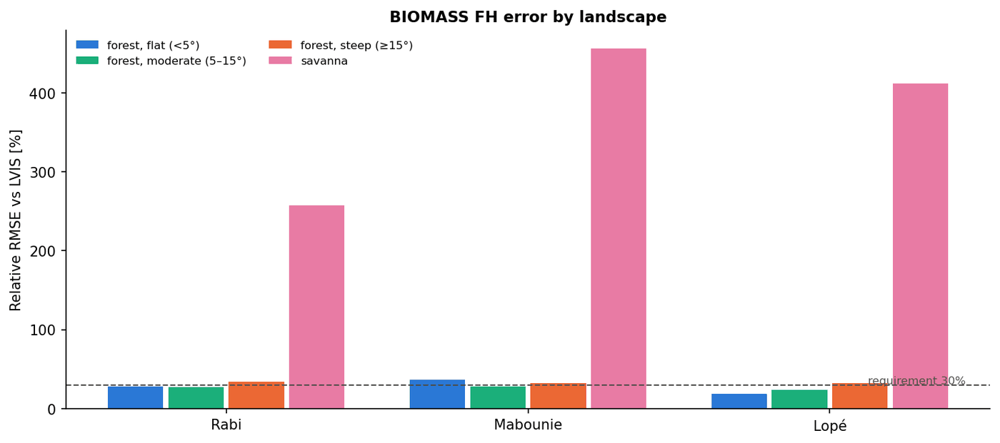
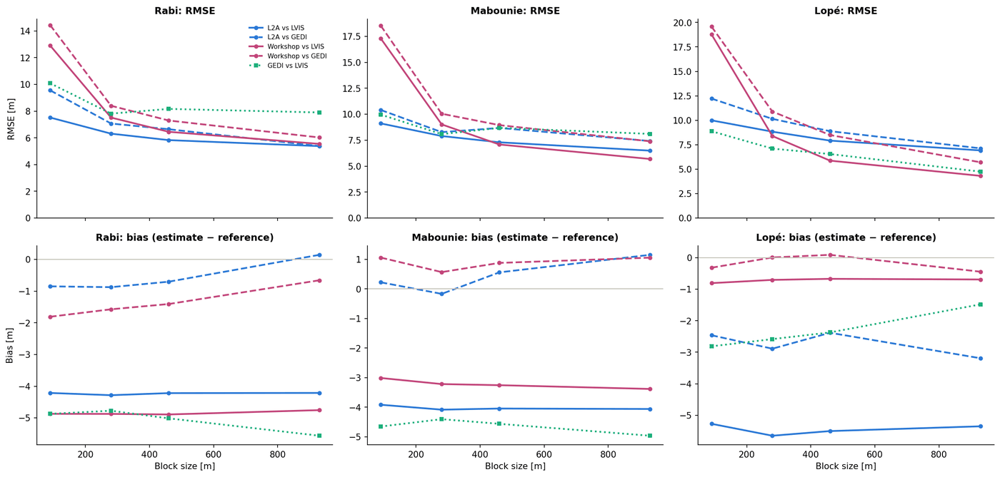
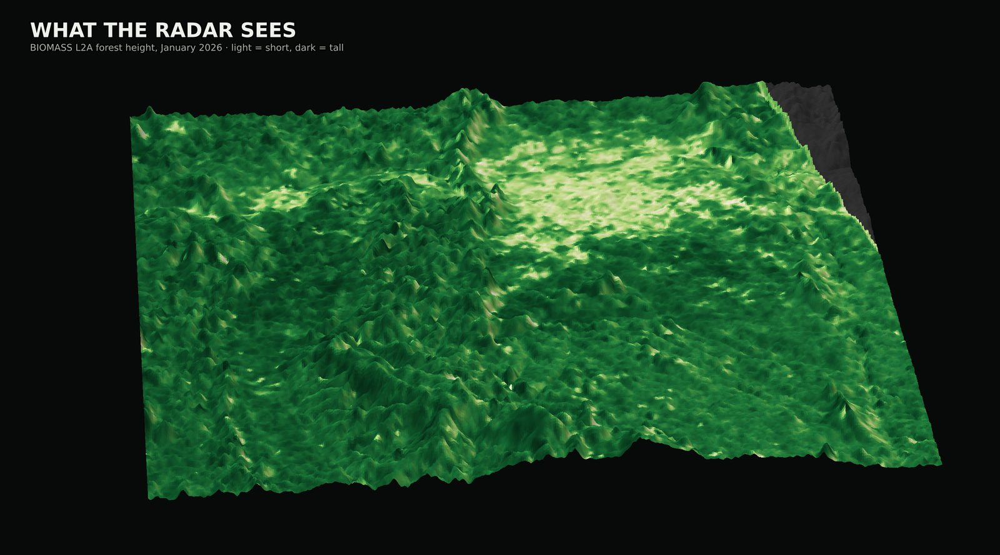

# BIOMASS and GEDI intercomparison

**Challenge #5, Canopy Clash: BIOMASS and GEDI intercomparison analytics**

## Goal

Bridge the spaceborne radar (ESA BIOMASS) and the spaceborne lidar (NASA GEDI). Implement a Jupyter notebook to access both datasets, visualise forest height estimates side by side, derive standard statistics, and automatically produce a short report in ppt format.

## Roadmap

- **Foundation**: a notebook that co-locates and ingests matching BIOMASS and GEDI observations and computes statistical indicators to compare forest height metrics.
- **Deep dive**: an automated reporting backend that compiles the analytics into a slide deck or document.

## Extra challenge

Implement a tomographic processor and a multi-instrument profile visualisation tool to slice and compare cross-sectional canopy profiles from BIOMASS and GEDI, and compare both with ALS.

## Data sources

- BIOMASS core mission products (L2A forest height, MAAP catalogue)
- GEDI space-lidar footprints, from [gediDB](https://gedidb.readthedocs.io/) (public, no login)
- NASA LVIS airborne LiDAR, AfriSAR 2016, Gabon (ORNL DAAC, Earthdata login) — used as the reference
- Workshop forest-height products, BIOMASS-Coding2026 (MAAP `Examples_and_Data`)
- Context layers: ESA WorldCover, Copernicus DEM, Sentinel-2 (gallery only)

## Status

**Foundation and deep dive: done for three sites in Gabon.** Extra challenge (tomography, ALS profiles): in progress, to be added by the group.

### The story: when can we trust BIOMASS forest height?

Three AfriSAR sites where airborne LiDAR gives a wall-to-wall reference: **Rabi** (flat closed forest, the control), **Mabounie** (hilly forest, seen from both orbit directions) and **Lopé** (forest, savanna and hills). Every dataset is put on the BIOMASS grid of each site, and errors are always *estimate − reference* (negative = BIOMASS too low).

| Finding | Numbers (BIOMASS L2A − LVIS) |
| --- | --- |
| Good in flat closed forest | RMSE 6.7 m (Lopé, 18 %), 7.1 m (Rabi, 28 %), 8.7 m (Mabounie, 36 %) |
| Too low on steep slopes (≥ 15°) | bias −6 to −9 m |
| Too high on savanna (noise read as canopy) | bias +12 to +17 m |
| Worst on slopes facing the radar (local incidence < 20°) | −12 to −20 m: the opposite of the simple k_z prediction, so foreshortening dominates |
| Ascending and descending see different errors | correlation of the two error maps only r = 0.24 – 0.64 |
| Repeat passes on the same track | differ by 6 – 8 m RMSE |
| Second product (workshop FH) | worse per pixel (RMSE 13 – 19 m vs 7.5 – 10 m) but better once averaged to ~1.4 km at Lopé (4.6 vs 6.9 m) and Mabounie (5.7 vs 6.1 m) |
| GEDI as a referee | GEDI is itself 3 – 5 m lower than LVIS, so BIOMASS looks almost unbiased against GEDI (−0.8 to +1.0 m) while it is 1.4 – 4.1 m too low against LVIS |

Caveat: LVIS was flown in 2016 and BIOMASS in 2026, so ten years of forest change are part of the differences.

| Where to trust BIOMASS L2A | GEDI as a referee |
| --- | --- |
|  |  |



## Folder layout

```text
05_BIOMASS_AND_GEDI/
├── README.md
├── requirements.txt
├── ruff.toml                 # lint settings for this folder (line length 120)
├── config/sites.json         # sites, bounding boxes, data URLs, dates: no paths in the code
├── notebooks/
│   ├── 01_three_sites_story.ipynb               # BIOMASS L2A vs LVIS and GEDI at 3 sites → Gabon_three_sites_report.pptx
│   ├── 02_second_product_and_gedi_referee.ipynb # workshop FH vs L2A, error vs scale, GEDI as referee → Workshop_FH_vs_L2A.pptx
│   └── 03_gabon_gallery.ipynb                   # print-quality pictures of Gabon → Gabon_gallery.pptx
├── docs/figures/             # three small figures for this README
├── scripts/fetch_gedi.py     # small download script for the GEDI shots of every site
├── src/
│   ├── load/       # read products into arrays (no plotting): biomass, lidar, gedi, context, workshop
│   ├── process/    # arrays in → arrays out: grid, geometry (heading, incidence, LIA), site, strip, aggregate
│   └── evaluate/   # numbers only: metrics, accuracy (strata, geometry, dates), multiscale (scale, GEDI referee)
├── tests/          # pytest for metrics, geometry and aggregation
├── data/           # downloaded data (git-ignored, ~200 MB)
└── results/        # figures, tables and slide decks (git-ignored)
```

The notebooks only call the functions in `src/` and draw the figures.

## How to run

On the BIOMASS MAAP JupyterLab (the MAAP Python environment already has most packages):

```bash
git clone https://github.com/<you>/biomass-hackathon-2026.git
cd biomass-hackathon-2026/topics/05_BIOMASS_AND_GEDI
pip install -r requirements.txt
python scripts/fetch_gedi.py          # optional: notebook 01 also does it
```

Then open the notebooks in order (01 → 02 → 03) and choose *Restart kernel and run all*.

- **BIOMASS** scenes are cropped to each site and downloaded by notebook 01. It asks for the ESA MAAP `CLIENT_SECRET` and `OFFLINE_TOKEN` with a hidden prompt (or reads `ESA_CLIENT_SECRET` / `ESA_OFFLINE_TOKEN` from the environment). Nothing is written to disk.
- **LVIS** files are downloaded by notebook 01 with an interactive NASA Earthdata login (`earthaccess`, not persisted).
- **GEDI** comes from the public gediDB: no login.
- **Workshop FH** products are read in place from the MAAP folder set in `config/sites.json` (`workshop_fh_dir`).
- Notebook 03 also downloads Sentinel-2 (Element 84 Earth Search) and Copernicus DEM tiles once, and caches them in `data/gallery/`.
- Already have the data? Set `SKIP_DOWNLOADS=1` to run without any download or prompt.

Checks:

```bash
ruff check src tests scripts && ruff format --check src tests scripts
pytest -q tests
```

## Authors

Sara Auditano and group 05_BIOMASS_AND_GEDI, ESA BIOMASS MAAP Hackathon 2026. Apache 2.0, like the rest of the repository.
